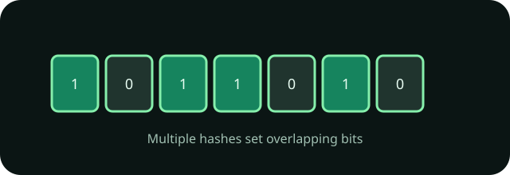

<div align="center">


<p><strong>A browser playground for Bloom filters and probabilistic membership.</strong></p>
   
<br/>
</div>

## 🧭 Overview
Bloom Filter Lab demonstrates a compact probabilistic set. Add values to a bit array, then query membership. A negative answer is definitive; a positive answer may be a false positive.

## ✨ Features
- 🧮 Configure bit-array size and hash count.
- ➕ Insert values and inspect the bits they set.
- 🔎 Query membership with clear “possible” semantics.
- 📈 Estimate the theoretical false-positive probability.
- 🔒 Keep all data in browser memory.

## 🎬 Demo
Start the app. It preloads three sample words; query one of them, then try a new value and observe how the bit array changes.

## 🚀 Quick Start
Requires Node.js 20 or newer.

```bash
npm start
```

Open http://127.0.0.1:4178. Run checks with npm test.

## 🧰 Tech Stack
- 🟢 Node.js built-in HTTP server
- 🌐 Browser JavaScript and typed arrays
- 🧪 Node.js built-in test runner

## 🗂️ Folder Structure
```text
public/       Bloom filter model and interface
test/         Membership behavior tests
assets/       Original SVG artwork
.github/      CI workflow
server.js     Dependency-free static server
```

## 🛣️ Roadmap
- [ ] Add an optimal hash-count calculator.
- [ ] Compare multiple bit-array configurations.
- [ ] Add a side-by-side counting Bloom filter lesson.

## 🤝 Contributing
Contributions are welcome. Preserve the no-false-negative property for inserted values and document the limits of the demonstration hashes.

## 📄 License
MIT. See LICENSE.

<div align="center"></div>
